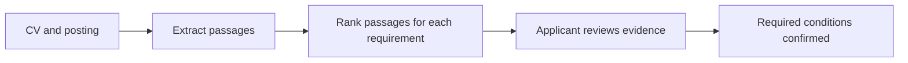

# Job Radar · CV-to-Job Match

[Try the public Hugging Face Space](https://huggingface.co/spaces/rezanicgil/job-radar-evidence) · [Browse the published dataset](https://huggingface.co/datasets/rezanicgil/job-radar-match-pilot)

Job Radar helps an applicant answer “Which requirements can I demonstrate in my CV, and what could I clarify before applying?” Open a PDF or TXT in the browser, select conditions from a Turkish or English posting, and attach CV passages to your assessment. The downloadable report preserves page references, selected wording and notes for your next CV edit.

## Example

Choose **Try a bilingual example** in the public Space. The fictional CV documents 30 months of C++ experience and Python test reporting. The job asks for 36 months of C++ and Python test reporting. Mark the first condition partial and the second supported, then select the relevant passages. The result is **50% coverage (1/2)**. The six-month shortfall and its source can travel with the exported report. This percentage counts fully documented conditions; hiring likelihood has not been measured.

Shared-word search includes 24 reviewed English and Turkish algorithm and data structure labels from [Wikidata](https://www.wikidata.org/wiki/Wikidata:Licensing). For example, “random forest” can retrieve a passage containing “rastgele orman.” The app links each matched pair to its concept and leaves the assessment to the reviewer. Matching uses whole phrases and does not cover every Turkish inflection. [Inspect the glossary](releases/static-space/bilingual-concepts.json)

### What the fine-tuning experiments established

The [downloadable research classifier](https://huggingface.co/rezanicgil/job-radar-evidence-mentions-v3) trained on 69 synthetic pairs. On 30 separate, author-labeled cases grounded in ten employers' postings, it matched 14 labels and missed all ten partial matches. Changing the job or CV language changed its prediction in 17 of the 30 cases. These results shaped the public product: the model research is inspectable, and applicants confirm their evidence before receiving a coverage percentage. [Explore recorded predictions and translations](https://rezanicgil-job-radar-evidence.static.hf.space/model.html) · [Contribute an independent review](https://rezanicgil-job-radar-evidence.static.hf.space/annotate.html)

### Türkiye market sample

On November 9, 2026, 44 employer boards returned 348 Türkiye-location postings. The title filter selected 86 postings across 21 employers, including data analysts, software architects and Turkish-language infrastructure and security roles. All 86 descriptions were readable. Python appeared in 35 of 86 postings across 14 employers. All 12 postings mentioning React Native came from one employer. The panel tracks 50 technology names and counts each posting URL once. Location-unconfirmed employer listings appear separately. [Inspect the dated counts](reports/skill-mentions-2026-11-09T172254Z.md)

Daily history uses the last collection on each Türkiye calendar day. To refresh, run `python scripts/market_inventory.py` followed by `python scripts/market_skills.py`. Publish the dated report files to GitHub before running `python scripts/publish_market.py` with Space write access. The publisher updates the snapshot and history in one commit. Run `python scripts/publish_market_dataset.py` to publish the same dated observations and technology denominators to the [Hugging Face market dataset](https://huggingface.co/datasets/rezanicgil/turkiye-software-job-market).

### Select conditions from a posting

Open “Find conditions in a job posting”, choose English or Turkish, paste the posting and select the conditions to review against your CV. Both selectors run locally. English uses a model for skill or knowledge mentions. Turkish uses section headings and qualification wording. A Turkish preference carried into the form starts excluded from required coverage; the reviewer can change its assessment. Keep line breaks when pasting Turkish postings so section boundaries remain visible.

The selector used [SkillSpan by Zhang et al.](https://aclanthology.org/2022.naacl-main.366/), [source revision](https://huggingface.co/datasets/jjzha/skillspan/tree/33062e6bd0e03a5e01ae299ce0518f4613ef4298). We kept the authors' splits and removed exact normalized sentence repetitions within and across splits, in train/dev/test order. A sentence is positive if it contains any annotated skill or knowledge token. From 11,543 source rows we used 3,943 training, 2,438 development and 2,404 test sentences. The unigram classifier obtained 75.0% test F1 at a threshold selected on development data. It missed 224 of 882 positive test sentences. The last-layer MiniLM experiment obtained 25.2% F1 at its default decision rule. These measurements cover English sentence selection only. Reproduce the runs with `python scripts/skill_sentence_baseline.py` and `python scripts/train_skill_sentences.py`. The demo distributes learned unigram weights. The upstream corpus and its source licenses are documented separately in SkillSpan.

### Run the local demo

From the repository root, create a Python virtual environment and activate it. Install the CPU dependencies, then start the service:

```sh
python -m pip install --index-url https://download.pytorch.org/whl/cpu torch==2.7.0
python -m pip install -r releases/evidence-space/requirements.txt
python scripts/demo.py
```

Open [the local demo](http://127.0.0.1:7860/) and try the fictional CV first. The [market view](http://127.0.0.1:7860/market) shows a dated snapshot with employer counts and source links. Model weights download on the first evidence search.

### Where the CV goes

The public Hugging Face Space processes the CV in the browser. The separate local Flask interface sends the document to your Flask server for temporary extraction. The server removes that directory on exit, including on a parsing error, and replies with a `no-store` cache directive.



### Matching example

> Java veya Kotlin ile üretim deneyimi şarttır.

**Required — Java or Kotlin.** Production experience in either language satisfies this requirement.

[The matching pilot](data/match_pilot.jsonl) pairs requirements with fictional CV passages. A `supported` passage covers the full requirement. A `partial` passage establishes a relevant part while leaving another unverified. An `unverified` passage supplies no relevant evidence. A CV may omit experience that the applicant actually has.

Count each grouped requirement once. Only fully supported required conditions enter the numerator. Keep preferred conditions separate. When the posting states no required technical conditions, show “No required technical conditions identified” and omit the percentage.

## Pilot dataset

[The pilot](data/pilot.jsonl) contains original, hand-authored examples for reviewing the labeling rules. Each record stores the posting language, the original text and a list of claims. A claim identifies the skills, their role in the posting and a verbatim evidence span. Grouped requirements distinguish `any_of` from `all_of`. An empty list means the sample contains no supported skill claims.

Small fine-tuning runs and a development challenge are available under `scripts/` and `reports/`. The public Static Space processes CVs in the browser and shows reviewer-confirmed coverage. Independent evaluation of the experimental classifier remains open.

## Review evidence in a local CV

With PyTorch, Transformers and pypdf installed, run `python scripts/review_cv.py my-cv.pdf "Production experience with Docker"`. The same command accepts UTF-8 TXT. It ranks extracted CV passages with the multilingual MiniLM base encoder and prints up to three candidates with page references. Check the wording yourself. Ranking is exploratory and supplies no verified match score. CV text is processed locally. The pinned public encoder is downloaded on first use.

## Reproduce the pilot baseline

For an interactive whole-posting review, run `python scripts/review_cv.py my-cv.pdf --posting job.txt`. Review the suggested CV passages for each distinct posting statement. Mark a required technical condition as supported, partial or unverified, and skip context and preferences. The final percentage counts only reviewer-confirmed supported statements among the selected required statements. A compound statement counts once; check all required parts before marking it supported.

Run `python scripts/evaluate_keywords.py` from the project root. The script uses the Python standard library. Its development examples illustrate errors in a vocabulary-based rule. See the [experiment protocol](research/methodology.md) for the planned held-out comparison.

Original project code is licensed under [Apache-2.0](LICENSE). The [dataset card](releases/match-pilot/README.md) describes synthetic-record provenance and licensing. The [research model card](releases/mentions-v3/README.md) identifies its base, revision, results and licensing.

Read the [portfolio case study](research/portfolio.md) or [report an evidence or market-data correction](https://github.com/rezanicgil/job-radar-evidence/issues/new?template=evidence_feedback.yml).
