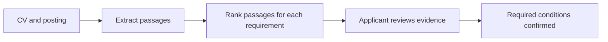

# Job Radar · CV-to-Job Match

[Try the public Hugging Face Space](https://huggingface.co/spaces/rezanicgil/job-radar-evidence) · [Browse the published dataset](https://huggingface.co/datasets/rezanicgil/job-radar-match-pilot)

[Download the fine-tuned research layers and run the bilingual classifier locally](https://huggingface.co/rezanicgil/job-radar-evidence-mentions-v3). The research model reproduced nine of 18 development labels and incorrectly credited full support twice. The public Space uses reviewer-confirmed coverage.

Job Radar is being designed for applicants who want to compare their CV with a Turkish, English or mixed-language software job posting. Each assessment will show the original requirement, the supporting CV passage and an English explanation. The first score measures the share of required technical conditions fully supported by the submitted CV.

## Example

### Run the local demo

From the repository root, create a Python virtual environment and activate it. Install the CPU dependencies, then start the service:

```sh
python -m pip install --index-url https://download.pytorch.org/whl/cpu torch==2.7.0
python -m pip install -r releases/evidence-space/requirements.txt
python scripts/demo.py
```

Open [the local demo](http://127.0.0.1:7860/) and try the fictional CV first. The [market view](http://127.0.0.1:7860/market) shows a dated snapshot with employer counts and source links. Model weights download on the first evidence search.

### Where the CV goes

The command-line reviewer reads the CV on your machine. In the web demo, the browser sends it to the server running the demo. Use the included fictional CV to try a hosted instance. The server extracts passages in a temporary directory and removes that directory on exit, including on a parsing error. The response contains matching passages and carries a `no-store` cache directive. Anyone reviewing a public deployment should also check its hosting and proxy logging settings.



### Matching example

> Java veya Kotlin ile üretim deneyimi şarttır.

**Required — Java or Kotlin.** Production experience in either language satisfies this requirement.

[The matching pilot](data/match_pilot.jsonl) pairs requirements with fictional CV passages. A `supported` passage covers the full requirement. A `partial` passage establishes a relevant part while leaving another unverified. An `unverified` passage supplies no relevant evidence. A CV may omit experience that the applicant actually has.

Count each grouped requirement once. Only fully supported required conditions enter the numerator. Keep preferred conditions separate. When the posting states no required technical conditions, show “No required technical conditions identified” and omit the percentage.

## Pilot dataset

[The pilot](data/pilot.jsonl) contains original, hand-authored examples for reviewing the labeling rules. Each record stores the posting language, the original text and a list of claims. A claim identifies the skills, their role in the posting and a verbatim evidence span. Grouped requirements distinguish `any_of` from `all_of`. An empty list means the sample contains no supported skill claims.

Small fine-tuning runs and a development challenge are available under `scripts/` and `reports/`. The public Static Space processes CVs in the browser and shows reviewer-confirmed coverage. Independent evaluation of the experimental classifier remains open.

## Review evidence in a local CV

With PyTorch, Transformers and pypdf installed, run `python scripts/review_cv.py my-cv.pdf "Production experience with Docker"`. The same command accepts UTF-8 TXT. It ranks extracted CV passages with the multilingual MiniLM base encoder and prints up to three candidates with page references. Check the wording yourself. Ranking is exploratory and supplies no verified match score. CV text is processed locally. The pinned public encoder is downloaded on first use.

## Reproduce the pilot baseline

For an interactive whole-posting review, run `python scripts/review_cv.py my-cv.pdf --posting job.txt`. Review the suggested CV passages for each distinct posting statement. Mark a required technical condition as supported, partial or unverified, and skip context and preferences. The final percentage counts only reviewer-confirmed supported statements among the selected required statements. A compound statement counts once; check all required parts before marking it supported.

Run `python scripts/evaluate_keywords.py` from the project root. The script uses the Python standard library. Its development examples illustrate errors in a vocabulary-based rule. See the [experiment protocol](research/methodology.md) for the planned held-out comparison.

Original project code is licensed under [Apache-2.0](LICENSE). This code license does not grant rights to CV uploads, third-party postings or upstream model weights. Dataset and model licenses will be documented per release.

Read the [portfolio case study](research/portfolio.md) or [report an evidence or market-data correction](https://github.com/rezanicgil/job-radar-evidence/issues/new?template=evidence_feedback.yml).
